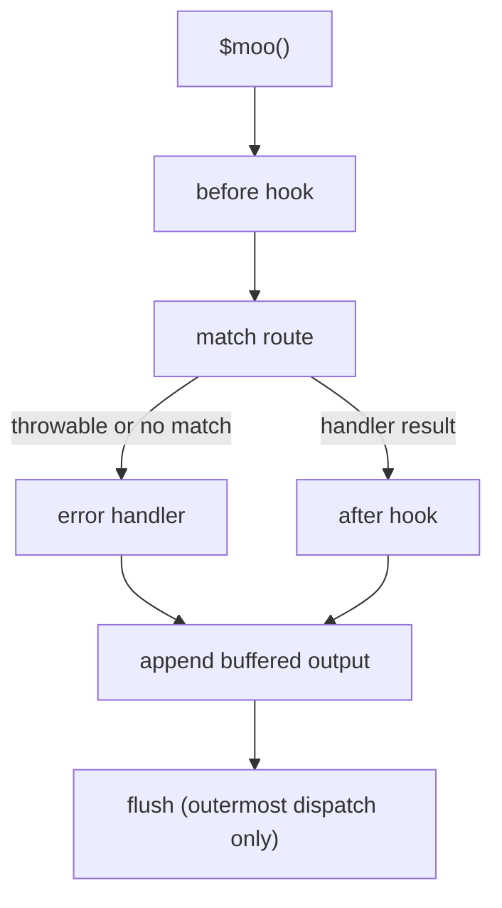

# Moo

Moo is a small, dependency free PHP front controller. It gives you regex based
routing, request and response models, a predictable request lifecycle and native
PHP templating in a handful of classes, without pulling in a framework.

It is meant for the cases where raw `.php` scripts would otherwise be the answer,
but you still want routing, hooks and testable handlers. If you need an
ecosystem, use Symfony or Laravel; Moo deliberately has none.

## Requirements

- PHP 8.0 or newer (the code is written to run on 8.0 through 8.5)
- No runtime dependencies

Development tooling (PHPUnit 10.5) requires PHP 8.1 or newer.

## Installation

~~~
composer config minimum-stability dev
composer require hellworx/moo:dev-main
~~~

## Hello World

Simplest Moo application.

~~~php
<?php
$moo = new Moo\Moo();

$moo->get('/', function () {
    return "Hello, this is Moo!";
});

$moo();
~~~

## Usage

This is the sample Moo app with more features presented like state container, plugins and parametrized routing.

~~~php
<?php
$moo = new Moo\Moo();

// Use moo as service container, inject dependency.
$moo->bookService = new App\BookService();

// Override the before hook to set Content-Type header.
$moo->before = function () use ($moo) {
    $moo->response->headers->set('Content-Type', 'application/json');
};

// Override the after hook to serialize output to JSON.
$moo->after = function () use ($moo) {
    $moo->response->body = json_encode($moo->response->body);
};

// Custom plugin.
$moo->findBookById = function ($bookId) use ($moo) {
    return $moo->bookService->find($bookId);
};

// Define index handler.
$moo->get('/', function () {
    echo "Hello, this is Moo bookstore!";
});

// Define `GET /books/<id>` handler.
$moo->get('/books/(\d+)', function ($bookId) use ($moo) {
    return $moo->findBookById($bookId);
});

// Run Moo.
$moo();
~~~

## Templates

Moo supports native PHP templates, however you can extend the base class and render templates with any other engine.
See the `website` example in `examples`.

~~~php
use Moo\Moo;
use Moo\Template;

$moo = new Moo();

// Create template renderer.
$moo->template = new Template(__DIR__ . '/templates', [
    'foo' => 'bar'
]);

// Custom template plugin.
$moo->template->date = function () {
    return date('Y-m-d');
};

// Index page handler.
$moo->get('/', function () use ($moo) {
    return $moo->template->render('index.phtml', [
        'hello' => 'world'
    ]);
});

~~~

Sample PHP template code.

~~~html

foo = <?php echo $foo ?>

hello = <?php echo $hello ?>

date = <?php echo $this->date() ?>

~~~

Templates are confined to the lookup directory, partials are included relative
to the template that includes them, and template context cannot override the
renderer internals.

## Classy Moo

Some may need a to write a posh code, if you need style you may try the following.

~~~php
<?php

use Moo\Moo;

class Application extends Moo
{
    public function __construct()
    {
        parent::__construct();
        $this->get('/', [$this, 'index']);
    }

    public function index()
    {
        echo 'Hello World';
    }
}

$app = new Application();
$app();
~~~

Hooks can be overridden as methods too, they take precedence over properties.

Test it and make your colleagues happy.

~~~php
<?php

use PHPUnit\Framework\TestCase;
use Moo\Request;

class ApplicationTest extends TestCase
{
    public function testIndex()
    {
        $request = new Request();
        $request->method = 'GET';
        $request->uri = '/';

        $app = new Application();
        $app->flush = null;     // You don't want output buffer flush in the unit tests.
        $app($request);

        $this->assertEquals(200, $app->response->code);
        $this->assertEquals('Hello World', $app->response->body);
    }
}
~~~

## Nesting

You can actually use one instance of Moo as a callback in another Moo.

~~~php
<?php

use Moo\Moo;

$usersMoo = new Moo();
$usersMoo->get('/users/(\d+)', function ($id) {
    // ...
});

$booksMoo = new Moo();
$booksMoo->get('/books/(\d+)', function ($id) {
    // ...
});

$moo = new Moo();
$moo->route('/users/.*', $usersMoo);
$moo->route('/books/.*', $booksMoo);

$moo();
~~~

Only the outermost dispatch flushes, so the output from nested apps is sent once.

## Examples

There are some examples in the `examples` directory.
To run them you can use builtin PHP server.

~~~
php -S 0.0.0.0:8080 examples/hello-world/index.php
~~~

## Documentation

The goal of Moo is simplicity, flexibility and ease of use.

### Concepts

Moo is written in PHP and is closure based. From design perspective it is a front controller, the `Moo\Moo` class exposes a set of standard HTTP methods to bind routing handlers as closures. Additionally, Moo acts as a state container and can be extended with plugins.

All Moo components reside in the PSR-4 `Moo` namespace. The main component is the
`Moo\Moo` class. There are four models: `Moo\Request`, `Moo\Response`, `Moo\Route`
and the `Moo\Router` that works as dispatcher.

Moo does output buffering, so you can simply output with echo or return a serializable value in the closure.

`Moo\Model` and `Moo\Collection` provide the small amount of data plumbing Moo
needs, so the library stays dependency free.

### Lifecycle

Here is what happens when you call `$moo(...)`:

The response body is whatever the handler returned. Output produced with `echo`
is buffered and appended to the body after the `after` hook ran.

### Routing

You can bind handlers to standard HTTP methods:
- GET: `$moo->get(...)`
- HEAD: `$moo->head(...)`
- POST: `$moo->post(...)`
- PUT:  `$moo->put(...)`
- DELETE: `$moo->delete(...)`
- CONNECT: `$moo->connect(...)`
- OPTIONS: `$moo->options(...)`
- TRACE: `$moo->trace(...)`
- PATCH: `$moo->patch(...)`

You can match multiple methods using `$moo->route(...)`.

Routes are matched from the first to the last. If no route matches the request, the error handler is called `$moo->error(...)`.
Registering the same method and URI twice replaces the earlier route.

Route URIs are regular expressions, so characters with a special meaning in a
pattern have to be escaped. Invalid patterns are rejected when the route is
registered.

### Parameters

Route can be parametrized with regular expressions.

~~~php
$moo->post('/orders/(\d+)/items/(\d+)', function ($orderId, $itemId) use ($moo) {
    return $moo->orderService->findOrderItem($orderId, $itemId);
});
~~~

Capture groups are passed to the handler as arguments, in order.

### Before & After hooks

There are two handlers pre and post request, the before and the after.

~~~php
$moo->before = function () {
    echo "Hey I'm the before hook";
};
$moo->after = function () {
    echo "Hey I'm the after hook";
};
$moo();
~~~

### Error Handling

By default exceptions and errors are handled by the error handler, that also works when no route matches request.

~~~php
$moo->error = function (\Throwable $exc) use ($moo) {
    $moo->response = new Response([
        'code' => $exc->getCode() > 0 ? $exc->getCode() : 500,
        'message' => StatusCode::message($exc->getCode()),
        'body' => $exc->getMessage()
    ]);
};
~~~

The handler receives a `\Throwable`. If the exception code is not a valid HTTP
status code (400 to 599), `500` is used. The `after` hook is not executed when
the error handler runs.

### Request

The `Moo\Request` class consists of:
- method
- uri
- baseUri
- headers
- query
- post
- files
- body

Request object `$moo->request` is created before `before` with the values taken from PHP global variables, `$_SERVER`, `$_GET`, `$_POST`, `$_FILES`.

*Request body is empty by default!*
You can override that in the `before` hook:

~~~php
$moo->before = function () use ($moo) {
    $moo->request->body = file_get_contents('php://input');
};
~~~

`baseUri` is the directory the front controller script runs in, extracted from
the script name. It is `/` when it cannot be determined.

### Response

The `Moo\Response` class consists of:
- body
- headers
- code
- message

Response object `$moo->response` is created before `before` and can be modified during the request lifecycle. Response body is not serialized, it is assumed you serialize it before `flush` in `after`.

### State

You can use Moo to keep your application state.

~~~php
$moo->something = 123;
$moo->myState = [
    'config' => [
        'host' => 'localhost',
        'port' => 1234
    ]
];
~~~

### Plugins

You can extend Moo with custom functions.

~~~php
$moo->foobar = function () {
    return 123;
};
$moo->foobar();
~~~

Calling an undefined plugin throws `BadMethodCallException`.

### Collection

`Moo\Collection` is a small key/value container used for headers, query, post,
files and routes.

~~~php
$headers = new Moo\Collection(['Accept' => 'text/html']);

$headers->set('X-Test', '1');
$headers->add('appended');
$headers->get('missing', 'default');
$headers->has('Accept');
$headers->remove('X-Test');
$headers->count();

foreach ($headers as $name => $value) {
    // ...
}

$headers->Accept;   // magic read
$headers['Accept']; // ArrayAccess
~~~

`get()` returns the given default when the key does not exist, `has()` reports
presence (a `null` value is still present).

### Model

`Moo\Model` is the base for `Request`, `Response` and `Route`. It can be
populated from an array and converted back.

~~~php
$request = new Moo\Request([
    'method' => 'POST',
    'headers' => ['Content-Type' => 'application/json'],
    'query' => ['page' => 1],
]);

$request->headers->get('Content-Type');
$request->toArray();
~~~

`populate()` only assigns declared properties and fills nested `Collection`s
from arrays. Unknown keys are ignored.

### Flush & Output Buffering

By default all output is buffered and then flushed at the end of `$moo()` execution.
You can override that behaviour by setting custom flush handler.

~~~php
$moo->flush = function () use ($moo) {
    header('HTTP/1.1 ' . $moo->response->code . ' ' . $moo->response->message);
    foreach ($moo->response->headers as $name => $value) {
        header($name.': '.$value, true);
    }
    echo $moo->response->body;
};
~~~

The flush handler only runs for the outermost dispatch, so nested apps and Moo
embedded in another output buffered application still return the flush result.
Setting `$moo->flush = null` disables flushing, which is handy in tests.

## PHP Compatibility

Moo targets PHP 8.0 and newer and is written to stay clean on 8.1 through 8.5:

- dynamic state and plugins are enabled with `#[\AllowDynamicProperties]`
- nullable parameters are explicit (`?array $context = null`)
- collections are iterated with generators, not `ArrayIterator`
- no `null` array offsets, no `ReflectionProperty::setAccessible()`, no `Serializable`
- no `strict_types`, so typed handler parameters keep the usual PHP coercion

## Testing

Moo is unit tested, just run `make test`. Static check of all PHP files is `make lint`.

## Contributing

The repository lives at https://github.com/hellworx/moo.
Contributions are welcome, please submit a pull request.

## License

MIT
